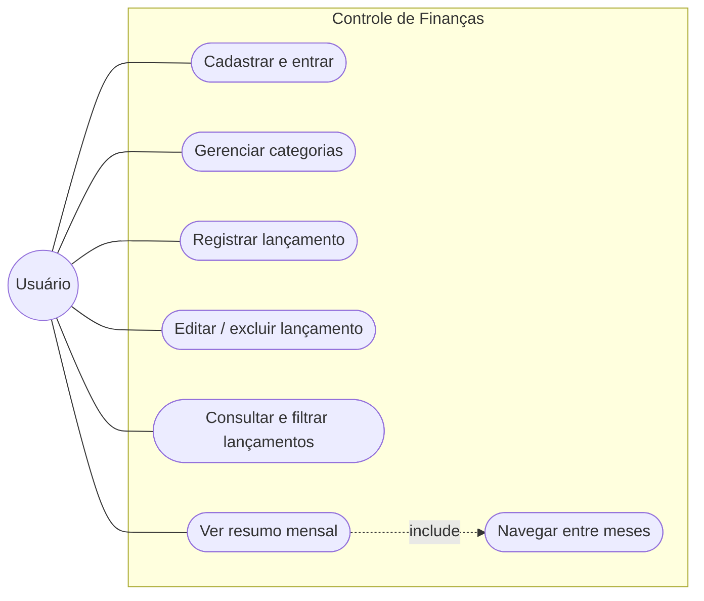
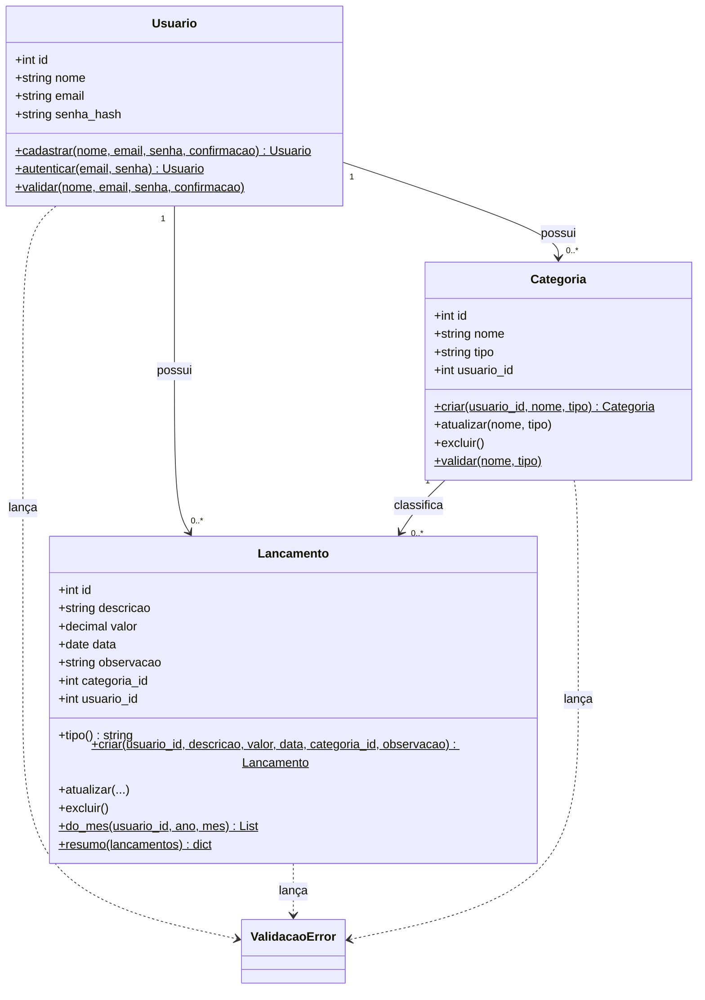
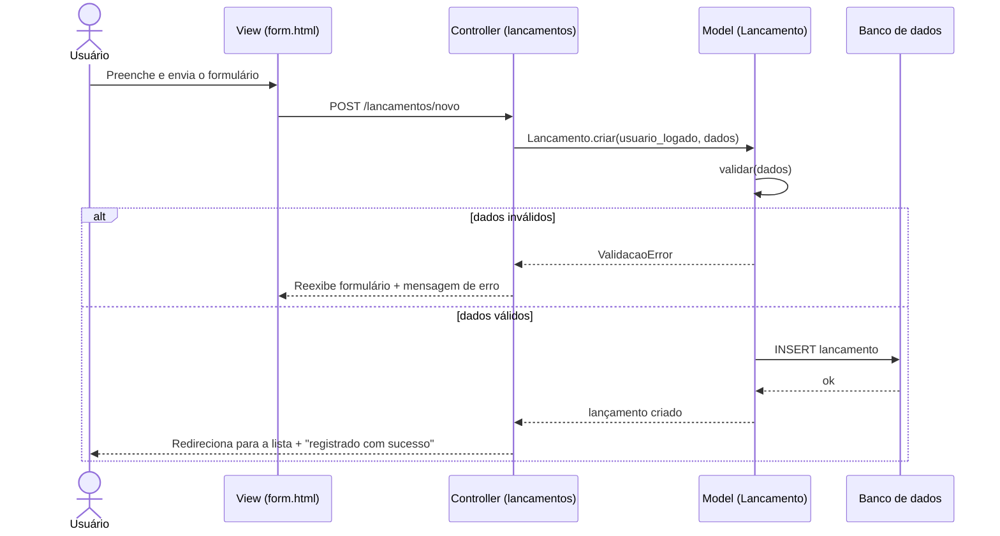
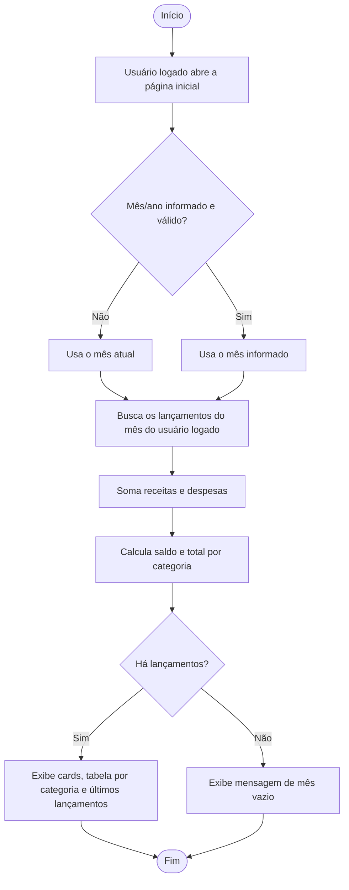
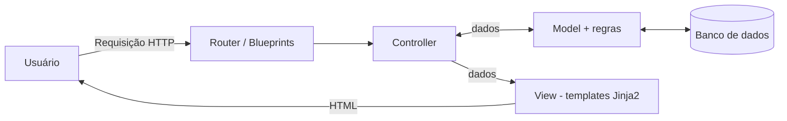

# 2. Modelagem UML

> Os diagramas usam Mermaid e são exibidos automaticamente no GitHub.

## 2.1 Casos de uso

| Caso de uso | Fluxo principal | Fluxo de exceção |
|---|---|---|
| **Cadastrar e entrar** | 1. Usuário abre "Criar conta". 2. Informa nome, e-mail, senha e confirmação. 3. Sistema valida, grava a senha como hash, cria as categorias padrão do usuário e já o deixa logado. Depois, para voltar: "Entrar" com e-mail e senha; "Sair" encerra a sessão. | E-mail repetido, senha com menos de 6 caracteres, senhas diferentes ou e-mail inválido: o sistema mostra o erro e mantém nome e e-mail. Login errado: "E-mail ou senha incorretos.". Sem login, qualquer tela interna leva a "Faça login para continuar." |
| **Registrar lançamento** | 1. Usuário abre "Novo lançamento". 2. Preenche descrição, valor, data e categoria. 3. Confirma. 4. Sistema valida, grava e exibe mensagem de sucesso. | Dado inválido (ex.: valor ≤ 0): o sistema mostra o erro e mantém o que o usuário digitou. |
| **Gerenciar categorias** | Criar, editar ou excluir categoria. | Nome repetido ou exclusão de categoria em uso: o sistema bloqueia e explica o motivo. |
| **Ver resumo mensal** | Usuário abre a página inicial; o sistema calcula receitas, despesas, saldo e totais por categoria do mês atual. | Mês sem dados: mensagem "Nenhum lançamento neste mês ainda". |

## 2.2 Diagrama de classes

## 2.3 Diagrama de sequência — registrar lançamento

## 2.4 Diagrama de atividades — resumo mensal

## 2.5 Arquitetura MVC

| Camada | Pasta | Responsabilidade |
|---|---|---|
| Model | `backend/app/models/` | Entidades, validação, regras de negócio e consultas |
| View | `frontend/templates/` + `frontend/static/` | HTML (Jinja2) e CSS |
| Controller | `backend/app/controllers/` | Recebe a requisição, chama o model, escolhe a view |
