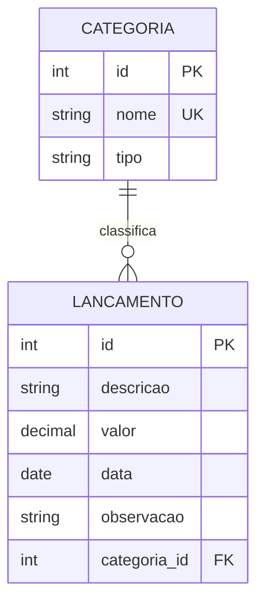

# 3. Projeto de Banco de Dados

SGBD: **PostgreSQL** em produção e **SQLite** em desenvolvimento (ambos populares e de fácil manutenção),
acessados pelo ORM SQLAlchemy.

## 3.1 Projeto conceitual (DER)

Uma categoria classifica zero ou muitos lançamentos; cada lançamento pertence a exatamente uma categoria.

## 3.2 Projeto lógico (normalizado)
- `categoria (id PK, nome UNIQUE, tipo)`
- `lancamento (id PK, descricao, valor, data, observacao, categoria_id FK → categoria.id)`

**Normalização**
- **1FN:** todos os atributos são atômicos (sem listas ou grupos repetidos).
- **2FN:** todas as chaves primárias são simples, então não há dependência parcial.
- **3FN:** o tipo (receita/despesa) depende da categoria e fica só em `categoria`. Não é repetido em
  `lancamento`, o que evita redundância e inconsistência (o tipo do lançamento é obtido pela categoria).

## 3.3 Projeto físico
O script completo está em [`database/schema.sql`](../database/schema.sql). A carga inicial está em [`database/dados_iniciais.sql`](../database/dados_iniciais.sql)..

## 3.4 Dicionário de dados

### Tabela `categoria`
| Campo | Tipo | Tamanho | Nulo? | Chave | Domínio / Regra | Descrição |
|---|---|---|---|---|---|---|
| id | INTEGER | – | Não | PK | Autoincremento | Identificador da categoria |
| nome | VARCHAR | 50 | Não | UNIQUE | Texto não vazio; único sem diferenciar maiúsculas/minúsculas (RN05) | Nome da categoria |
| tipo | VARCHAR | 10 | Não | – | `receita` ou `despesa` | Natureza da categoria |

### Tabela `lancamento`
| Campo | Tipo | Tamanho | Nulo? | Chave | Domínio / Regra | Descrição |
|---|---|---|---|---|---|---|
| id | INTEGER | – | Não | PK | Autoincremento | Identificador do lançamento |
| descricao | VARCHAR | 100 | Não | – | Texto não vazio | O que foi recebido ou pago |
| valor | NUMERIC | 10,2 | Não | – | Maior que zero, até 99.999.999,99 | Valor em reais |
| data | DATE | – | Não | – | Data válida | Data do recebimento/pagamento |
| observacao | VARCHAR | 255 | Sim | – | Texto livre | Detalhe opcional |
| categoria_id | INTEGER | – | Não | FK → categoria.id | Categoria existente | Categoria do lançamento |

### Relacionamento
| Origem | Destino | Cardinalidade | Regra de integridade |
|---|---|---|---|
| categoria.id | lancamento.categoria_id | 1 : N | Categoria com lançamentos não pode ser excluída (RN06) |

### Categorias padrão (carga inicial)
Receitas: Salário, Renda extra. Despesas: Alimentação, Moradia, Transporte, Lazer, Saúde.
