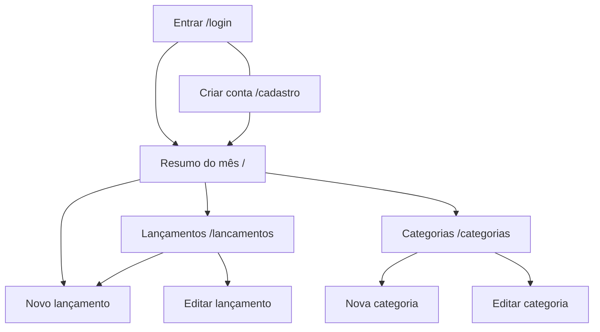

# 4. Interface Humano-Computador (IHC)

## 4.1 Mapa de navegação

Logado, todas as telas têm o mesmo menu no topo (Resumo, Lançamentos, Categorias), o nome do usuário e o botão "Sair". As telas **Entrar** e **Criar conta** não têm o cabeçalho: são um cartão centralizado com o logo, campos com rótulo animado e transição suave entre as duas telas; qualquer tela interna leva ao login.

## 4.2 Telas
| Tela | Objetivo | Imagem |
|---|---|---|
| Entrar | Acessar a conta com e-mail e senha (link para "Criar conta") | – |
| Criar conta | Cadastrar nome, e-mail, senha e confirmação (link para "Entrar") | – |
| Resumo | Ver receitas, despesas, saldo, total por categoria e últimos lançamentos do mês | `img/dashboard.png` |
| Lançamentos | Listar, buscar, filtrar, editar e excluir | `img/lancamentos.png` |
| Novo/Editar lançamento | Formulário com validação | `img/novo_lancamento.png` |
| Categorias | Gerenciar categorias | `img/categorias.png` |

### 4.2.1 Cabeçalho fixo e responsividade
- O cabeçalho é **fixo** (sticky) no topo em todas as telas, inclusive no celular, e não cobre o conteúdo.
- No celular (até 640 px): logo e nome do usuário com "Sair" na **mesma linha**; o menu (Resumo, Lançamentos, Categorias) fica logo abaixo.
- **Tabelas viram cartões** no celular (lançamentos, categorias e as do resumo): descrição e valor na 1ª linha, categoria e data na 2ª, ações embaixo; na lista de lançamentos, a caixa de seleção fica à esquerda. Sem rolagem horizontal.
- Resumo: o título cabe em uma linha e os 3 cartões ficam na mesma linha também no celular (um script reduz a fonte do valor até caber). Não há botão "Novo lançamento" nessa tela (ele fica em Lançamentos).
- **Barra do mês em uma linha só:** `‹ Mês anterior · [mês] [ano] · Próximo mês ›`; no computador ao lado do título e no celular só com as setas `‹ ›`. Escolher mês ou ano aplica na hora (sem botão "Ir").
- **Abas no celular:** "Por categoria" e "Últimos lançamentos" viram duas abas (uma lista por vez); no computador as duas listas aparecem lado a lado.
- Botão "Nova categoria" fica na linha do título.

### 4.2.2 Formulário de lançamento
- **Máscara de valor:** `123456` vira `1.234,56`; na edição o valor já vem formatado.
- **Data:** rótulo "Data da compra ou do recebimento" e ajuda "Informe o dia em que o gasto ou o recebimento aconteceu." (`aria-describedby`); o calendário já limita o intervalo permitido.
- **Repetir por quantos meses?** (só no novo lançamento): 1 = só este; até 60. Ajuda: "Ex.: 12 cria o mesmo lançamento todo mês, durante 12 meses."

### 4.2.3 Lista de lançamentos, filtros e navegação
- **Filtros automáticos:** não há botão "Filtrar"; a lista se atualiza ao mudar um campo (busca e valores esperam a pessoa parar de digitar). O botão "Limpar filtros" só aparece quando há filtro ativo. Sem JavaScript, aparece um botão "Filtrar".
- Campos com rótulo em cima e em grade: busca, tipo e categoria na primeira linha; **"Mais filtros"** (data de/até, valor mínimo/máximo, ordenar por e ordem) logo abaixo. No celular "Mais filtros" fica recolhido (e abre sozinho se algum deles estiver em uso); no computador fica aberto.
- Botões "Exportar CSV" e "Excluir selecionados" compactos; o de excluir só fica ativo quando há itens marcados e mostra a quantidade.
- Faixa com o **total filtrado** (quantidade, receitas, despesas e saldo) e botões **Exportar CSV** e **Excluir selecionados**; "selecionar todos" no topo da tabela. A exclusão em lote pede confirmação.
- **Paginação** de 20 em 20 ("Página 1 de 3").
- Categorias: filtro por tipo, também automático. Resumo: seletor de mês e ano junto de "Mês anterior" e "Próximo mês".

## 4.3 Princípios de IHC aplicados
| Princípio | Como foi aplicado |
|---|---|
| Clareza | Rótulos diretos ("Valor (R$)", "Salvar"); receitas em verde e despesas em vermelho, sempre com texto e sinal (+/−), sem depender só da cor |
| Consistência | Mesmo menu, botões e estilo de tabela e formulário em todas as telas |
| Simplicidade | Formulário com poucos campos; observação é opcional |
| Controle do usuário | O usuário decide o mês, os filtros e quando salvar; sempre há "Cancelar" |
| Resposta (feedback) | Mensagem de sucesso ou erro a cada ação |
| Recuperabilidade | Confirmação antes de excluir; o formulário com erro mantém o que foi digitado |
| Acessibilidade | Labels associados aos campos, foco visível, contraste adequado, layout responsivo |
| Padrões | Data em formato brasileiro (dd/mm/aaaa) e valores em R$ 1.234,56 |

## 4.4 Mensagens de erro e de sucesso
| Situação | Mensagem |
|---|---|
| Nome vazio (cadastro) | "O nome é obrigatório." |
| E-mail inválido | "Informe um e-mail válido." |
| Senha curta | "A senha deve ter no mínimo 6 caracteres." |
| Senhas diferentes | "A confirmação de senha não confere." |
| E-mail já cadastrado | "Já existe uma conta com esse e-mail." |
| Login incorreto | "E-mail ou senha incorretos." (genérica de propósito) |
| Tela interna sem login | Sem mensagem: o sistema apenas leva à tela de login |
| Cadastro / logout ok | "Conta criada com sucesso. Bem-vindo(a)!", "Você saiu da sua conta." |
| Data fora do intervalo | "Informe uma data entre 01/01/2000 e <data limite>." |
| Senha só de espaços | "A senha não pode conter apenas espaços." |
| Filtro de data/valor inválido | "Data inicial inválida: o filtro foi ignorado." (idem data final, valor mínimo/máximo) |
| Intervalo invertido | "A data inicial é maior que a final: ..." / "O valor mínimo é maior que o máximo: ..." |
| Repetição inválida | "Informe de 1 a 60 meses para repetir." |
| Repetição com descrição longa | "A descrição é grande demais para repetir; encurte-a." |
| Lote sem seleção | "Selecione ao menos um lançamento." |
| Lote / repetição ok | "3 lançamentos excluídos.", "4 lançamentos registrados com sucesso (um por mês)." |
| Descrição vazia | "A descrição é obrigatória." |
| Valor inválido | "Informe um valor numérico válido." |
| Valor ≤ 0 | "O valor deve ser maior que zero." |
| Data inválida | "Informe uma data válida." |
| Categoria não escolhida | "Selecione uma categoria válida." |
| Categoria repetida | "Já existe uma categoria com esse nome." |
| Excluir categoria em uso | "Não é possível excluir: existem lançamentos nesta categoria." |
| Página inexistente ou item de outro usuário | Tela "Página não encontrada" com botão para voltar ao início |
| Sucesso | "Lançamento registrado com sucesso.", "Categoria criada com sucesso." etc. |
