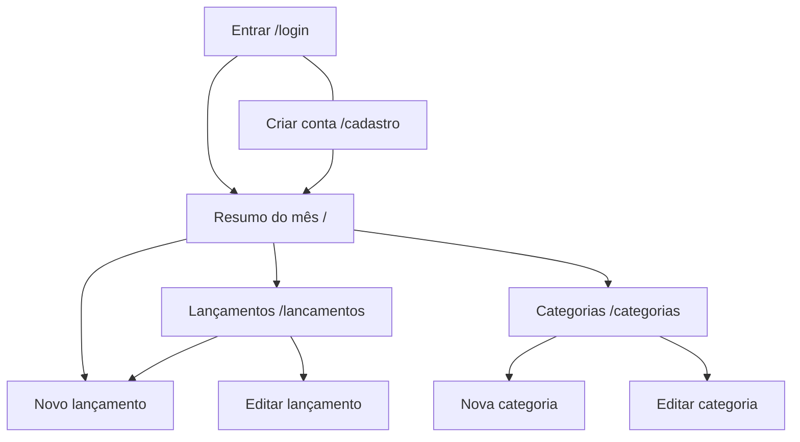

# 4. Interface Humano-Computador (IHC)

## 4.1 Mapa de navegação

Logado, todas as telas têm o mesmo menu no topo (Resumo, Lançamentos, Categorias), o nome do usuário e o botão "Sair". Deslogado, o menu mostra só "Entrar" e "Criar conta"; qualquer tela interna leva ao login.

## 4.2 Telas
| Tela | Objetivo | Imagem |
|---|---|---|
| Entrar | Acessar a conta com e-mail e senha (link para "Criar conta") | – |
| Criar conta | Cadastrar nome, e-mail, senha e confirmação (link para "Entrar") | – |
| Resumo | Ver receitas, despesas, saldo, total por categoria e últimos lançamentos do mês | `img/dashboard.png` |
| Lançamentos | Listar, buscar, filtrar, editar e excluir | `img/lancamentos.png` |
| Novo/Editar lançamento | Formulário com validação | `img/novo_lancamento.png` |
| Categorias | Gerenciar categorias | `img/categorias.png` |

## 4.3 Princípios de IHC aplicados
| Princípio | Como foi aplicado |
|---|---|
| Clareza | Rótulos diretos ("Valor (R$)", "Salvar"); receitas em verde e despesas em vermelho, sempre com texto e sinal (+/−), sem depender só da cor |
| Consistência | Mesmo menu, botões e estilo de tabela e formulário em todas as telas |
| Simplicidade | Formulário com poucos campos; observação é opcional |
| Controle do usuário | O usuário decide o mês, os filtros e quando salvar; sempre há "Cancelar" |
| Resposta (feedback) | Mensagem de sucesso ou erro a cada ação |
| Recuperabilidade | Confirmação antes de excluir; o formulário com erro mantém o que foi digitado |
| Acessibilidade | Labels associados aos campos, foco visível, contraste adequado, layout responsivo |
| Padrões | Data em formato brasileiro (dd/mm/aaaa) e valores em R$ 1.234,56 |

## 4.4 Mensagens de erro e de sucesso
| Situação | Mensagem |
|---|---|
| Nome vazio (cadastro) | "O nome é obrigatório." |
| E-mail inválido | "Informe um e-mail válido." |
| Senha curta | "A senha deve ter no mínimo 6 caracteres." |
| Senhas diferentes | "A confirmação de senha não confere." |
| E-mail já cadastrado | "Já existe uma conta com esse e-mail." |
| Login incorreto | "E-mail ou senha incorretos." (genérica de propósito) |
| Tela interna sem login | "Faça login para continuar." |
| Cadastro / logout ok | "Conta criada com sucesso. Bem-vindo(a)!", "Você saiu da sua conta." |
| Descrição vazia | "A descrição é obrigatória." |
| Valor inválido | "Informe um valor numérico válido." |
| Valor ≤ 0 | "O valor deve ser maior que zero." |
| Data inválida | "Informe uma data válida." |
| Categoria não escolhida | "Selecione uma categoria válida." |
| Categoria repetida | "Já existe uma categoria com esse nome." |
| Excluir categoria em uso | "Não é possível excluir: existem lançamentos nesta categoria." |
| Página inexistente ou item de outro usuário | Tela "Página não encontrada" com botão para voltar ao início |
| Sucesso | "Lançamento registrado com sucesso.", "Categoria criada com sucesso." etc. |
